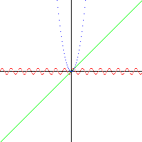
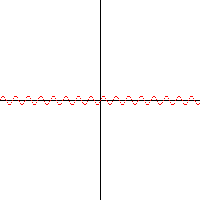
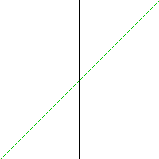
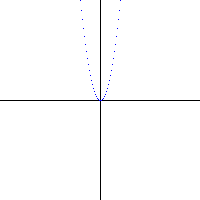
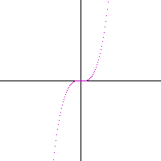
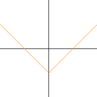
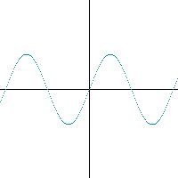
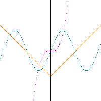

# grid-generator

Маленькая программа на C, которая рисует графики функций `y = f(x)` в координатной сетке и сохраняет результат в PNG.
Для записи картинки используется однофайловая библиотека [stb_image_write](https://github.com/nothings/stb).



## Сборка и запуск

```sh
cc -O2 -o grid_generator main.c -lm
./grid_generator
```

После запуска рядом появится `coordinate_system.png` (200×200): оси координат и три графика —
волна (красный), прямая (зелёный) и парабола (синий).

## Как добавить свою функцию

Функция принимает `x` (центр картинки — это 0, ось Y смотрит вверх) и возвращает `y`:

```c
int my_func(int x) {
    return x * x * x / 400;
}

make_grid(grid, my_func);
draw_grid(buffer, grid, 255, 0, 255); // цвет в RGB
```

## Примеры

| | | |
|:-:|:-:|:-:|
|  `5·sin(x/2)` |  `x` |  `x²/4` |
|  `x³/400` |  `abs(x) − 50` |  `40·sin(x/15)` |

Все вместе:



Примеры генерируются программой [`examples/gen_examples.c`](examples/gen_examples.c), которая переиспользует функции из `main.c`:

```sh
cd examples
cc -O2 -o gen_examples gen_examples.c -lm
./gen_examples
```
